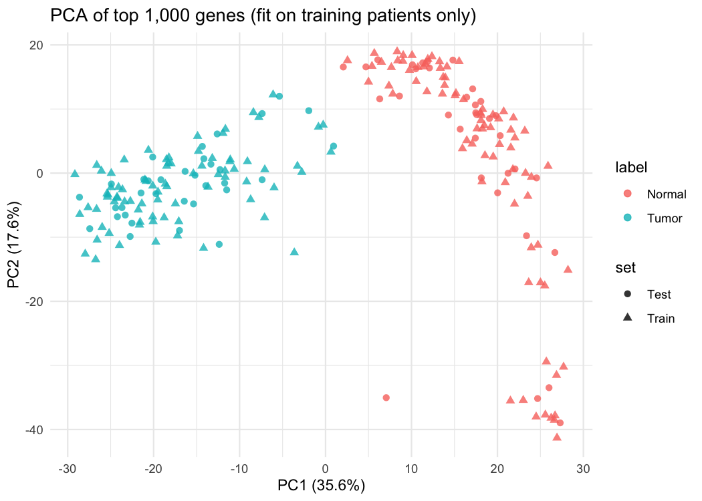
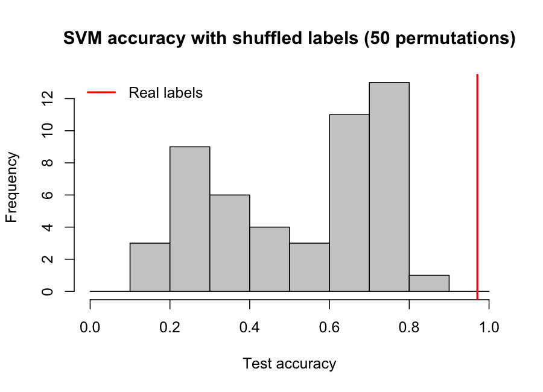
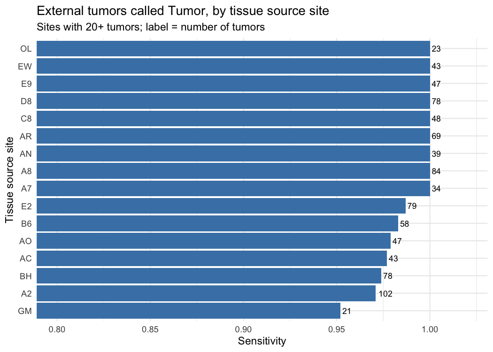

# Breast Cancer Tumor vs Normal Classifier (TCGA-BRCA)

Can gene expression alone tell breast tumor tissue apart from normal breast tissue, in a way that holds up on patients and hospitals the model has never seen?

This project started as my final project for a graduate RNA-seq course (Brandeis University, RBIF112). When I revisited it, I found two design problems that could inflate the results, rebuilt the analysis to remove them, and then tested the final model on 982 tumors it had never seen.

## Key results

| Check | Result |
|---|---|
| Held-out test set (68 samples from 34 new patients) | SVM 97.1%, logistic regression 98.5%, random forest 98.5% |
| Nested 5-fold cross-validation, grouped by patient | 99.6% mean accuracy (folds: 100, 100, 98, 100, 100%) |
| Permutation test (50 shuffled-label runs) | 51.5% mean, real model beat all 50 (p < 0.02) |
| External validation: 982 unseen tumors from 39 tissue source sites | **98.9% called Tumor (971 of 982)** |
| Same test, sites that never contributed a normal sample | 99.0% (701 tumors) vs 98.6% at sites that did (281 tumors) |

## Data

- **Source:** The Cancer Genome Atlas breast cancer project (TCGA-BRCA), RNA-seq gene counts (STAR - Counts), downloaded from the NCI Genomic Data Commons with `TCGAbiolinks`.
- **Available samples:** 1,111 primary tumors and 113 solid tissue normals (normal breast tissue collected near the tumor).
- Raw data is not included in this repository (about 5 GB). `R/01_get_data.R` downloads it.

## What was wrong with the first version

**1. Hospital was mixed up with the label.** The original analysis compared the first 113 tumors in the list against all 113 normals. Checking the tissue source site code in each TCGA barcode showed:

| Group | Number of sites | Share from the largest site (BH) |
|---|---|---|
| First 113 tumors | 25 | 12% |
| All 113 normals | 6 | **65%** |

Normal samples are rare in TCGA and most came from one site, while tumors came from many. A model could partly learn "what samples from site BH look like" instead of "what cancer looks like."

**2. The same patient could appear on both sides of the split.** Many patients contributed both a tumor and a normal sample. With a sample-level split, a patient's tumor could be in training and their normal in testing.

**3. Gene selection used every sample.** Normalization and the choice of the 1,000 most variable genes were done on all 226 samples before the train/test split, so the test samples influenced which genes the model used.

## How I fixed it

- **Matched tumor-normal pairs.** All 113 patients with a normal sample also have a tumor sample. I used one tumor (the 01A portion when available) and one normal from each, so both groups have an identical mix of tissue source sites.
- **Patient-level splits.** A 70/30 split by patient (79 training patients, 34 test patients), and `groupKFold` by patient for cross-validation, so both samples from a patient always stay together.
- **Per-sample normalization.** Switched from quantile normalization (which builds a reference from all samples) to log2 counts per million, which normalizes each sample on its own.
- **Gene selection inside training only.** Keep genes with CPM > 1 in at least 20% of training samples (17,237 genes), then the 1,000 with the highest variance in training. In nested cross-validation this is repeated inside every fold.

## Methods

1. **Exploration:** PCA fit on training samples only, with test samples projected onto the same components.
2. **Models** (`caret`):
   - SVM with radial kernel, tuned by 5-fold CV on ROC AUC (sigma and C)
   - Logistic regression on the top 30 principal components (1,000 genes is too many predictors for 158 training samples)
   - Random forest
3. **Validation:**
   - Held-out test set of 34 patients
   - Nested 5-fold cross-validation grouped by patient, with gene selection and tuning inside each fold
   - Permutation test: shuffle training labels 50 times and retrain to confirm accuracy drops to chance
4. **External validation:** train the final SVM on all 226 paired samples, then predict 982 tumors from patients not used anywhere in training (one tumor per patient). Results broken down by tissue source site and by PAM50 subtype.

## Results

### Tumor and normal separate clearly



PC1 (35.6% of variance) separates tumor from normal, and held-out test patients fall in the correct clusters even though PCA never saw them. PC2 (17.6%) mostly spreads out the normal samples, possibly reflecting differences in tissue composition between donors.

### Held-out test set (34 patients, 68 samples)

| Model | Correct | Accuracy | Tumor sensitivity | Specificity |
|---|---|---|---|---|
| SVM (radial) | 66 / 68 | 97.1% | 100% | 94.1% |
| Logistic regression (30 PCs) | 67 / 68 | 98.5% | 97.1% | 100% |
| Random forest | 67 / 68 | 98.5% | 100% | 97.1% |

The three models differ by one sample, which is within the uncertainty of a 68-sample test set (95% CI roughly 90 to 100%). The main difference is the type of error: logistic regression missed one tumor, while the SVM and random forest only made false positives on normal tissue.

### No leakage: shuffled labels drop to chance



With shuffled labels, accuracy averaged 51.5%, and none of the 50 runs reached the real model's 97.1%. The distribution has two peaks (around 25% and 75%) because tumor and normal samples form such distinct clusters that a model trained on random labels still splits them into two groups and then names those groups correctly or backwards depending on the shuffle. The peaks are symmetric around 50%, which is what you expect without leakage.

### External validation: 982 unseen tumors

The final model called 971 of 982 unseen tumors correctly (**98.9% sensitivity**).

**It learned cancer, not hospital.** Sensitivity was 99.0% at the 701 tumors from sites that never contributed a normal sample, and 98.6% at sites that did. If the model relied on site-specific signals, it would struggle at sites it never saw normals from.



Across the 16 sites with 20 or more tumors, sensitivity ranged from 95% to 100%. The 11 misses were spread across 8 sites.

**The misses have a biological explanation.** 8 of the 11 missed tumors belong to the PAM50 Normal-like subtype, whose expression profile resembles normal breast tissue:

| PAM50 subtype | Tumors | Called Tumor | Sensitivity |
|---|---|---|---|
| Basal | 173 | 173 | 100% |
| HER2-enriched | 73 | 73 | 100% |
| Luminal A | 500 | 497 | 99.4% |
| Luminal B | 187 | 187 | 100% |
| Normal-like | 38 | 30 | 78.9% |

Whether Normal-like is a true subtype or mainly reflects samples with low tumor purity is still debated, but either way these are the tumors you would expect to be hardest to distinguish from normal tissue.

## Limitations

- **Tumor vs normal is an easy problem.** Cancer changes gene expression dramatically, so high accuracy is expected. The value of this project is in checking that the estimate is trustworthy, not in the number itself.
- **Only 113 normal samples exist in TCGA-BRCA,** and all were used for training and testing. The external set contains only tumors, so it measures sensitivity, not specificity.
- **TCGA normals are tissue adjacent to a tumor,** not tissue from healthy people, and may already carry some tumor-related changes.
- **Tissue source site is only one possible batch variable.** Sequencing plate and processing date could also matter and were not modeled.
- The tuned SVM parameters fell at the edge of the search grid; a wider grid might change them slightly.

## Next steps

- Test specificity at scale using healthy breast tissue from GTEx, processed with the same pipeline (UCSC Xena TCGA/GTEx data), without retraining.
- Try a harder question: classifying PAM50 subtypes among tumors.

## How to run

Requires R (4.4) with `TCGAbiolinks`, `SummarizedExperiment`, `caret`, `kernlab`, `randomForest`, and `ggplot2`. Run from the repository root:

```r
source("R/01_get_data.R")            # select samples, download (~5 GB), prepare
source("R/02_train_and_validate.R")  # split, models, nested CV, permutation test
source("R/03_external_validation.R") # final model on 982 unseen tumors
```

Results are written to `results/` and figures to `figures/`.

## Repository structure

```
R/
  01_get_data.R              sample selection, site check, matched pairs, download
  02_train_and_validate.R    leakage-safe modeling and validation
  03_external_validation.R   final model and external test
results/                     CSV tables behind every number in this README
figures/                     PCA, permutation test, external validation by site
```

## Author

Stephanie Galvis, MS Bioinformatics, Brandeis University
